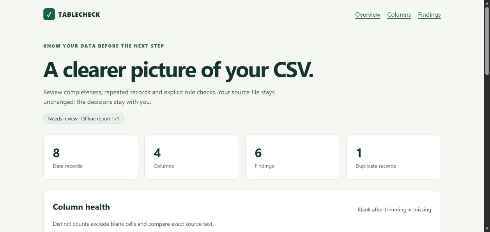

# TableCheck

Inspect a CSV before building a dashboard or training a model. TableCheck finds
missing cells, exact duplicate records and explicit schema-rule violations on
your computer. It never uploads data or changes the input file.



## Quick start

Requires Python 3.10 or newer. No pip install, API key, environment variables or
external service is needed. From this repository:

```sh
python -m tablecheck examples/clean.csv --schema examples/rules.json
python -m tablecheck examples/enrolments.csv --schema examples/rules.json
python -m tablecheck examples/enrolments.csv --schema examples/rules.json --format html --output report.html
python -m tablecheck examples/enrolments.csv --schema examples/rules.json --output report.json
```

Open `report.html` directly in a browser. Use the report navigation, expand the
methodology with Enter, or print using the browser's Print command. On narrow
screens, focus a table and use arrow keys to scroll it horizontally. A generated
synthetic example is included at [docs/example-report.html](docs/example-report.html).
Download or clone it to view locally; GitHub displays HTML source.

Use a new output name each time: existing files are never overwritten. The parent
folder must already exist. `--format` controls the exported file, while the
terminal always shows the summary. Without `--output`, no file is created.

| Exit | Meaning |
| --- | --- |
| 0 | Audit completed with no findings (including a header-only file) |
| 1 | Audit completed; findings need review. Output reports are still written. |
| 2 | Invalid arguments, input, schema or output path. Read stderr. |

The example with issues deliberately exits **1**: 8 records, 4 columns, 1 exact
duplicate, 6 findings. A blank required cell creates both `missing` and `required`
findings, so the finding total is not the number of affected rows or cells.

## Optional rules

```json
{
  "columns": {
    "completion": {"required": true, "type": "number", "min": 0, "max": 100},
    "cohort": {"allowed": ["November", "December"]}
  }
}
```

Column names must exactly match headers. Unknown rule keys, duplicate JSON keys,
missing columns and invalid bounds are errors. `type` can be `string` or `number`;
min/max require `number` and are inclusive. Numeric cells accept decimal or
scientific notation with optional surrounding whitespace, but not NaN, infinity,
underscores or thousands separators. `allowed` compares exact, case-sensitive,
untrimmed strings. Optional blank cells skip type/category checks; all blanks
still appear in the missingness profile. Rules never guess business meaning.

JSON report version 1 includes rows, column profiles, duplicate_rows, issue_count,
issues (code/record/column) and issues_truncated. No input values are exported.
Column names are included: check them before sharing. Keep the original CSV and
schema to interpret the report; filenames and rule definitions are not embedded.

## Design decisions and limits

- Standard-library Python keeps setup offline and dependencies small.
- Raw cells stay unchanged. Missing means whitespace-only or empty. Distinct
  nonblank values and duplicate rows use exact raw strings, including spaces.
- CSV record numbers include the header. Quoted multiline cells do not increment
  the record number multiple times. Records are not physical text-editor lines.
- UTF-8 with optional BOM, comma delimiter, unique nonblank headers and consistent
  row widths only. Blank records, malformed quotes and NUL bytes are rejected.
- Up to 10 MiB input, 100,000 data records, 200 columns and 128 KiB per field.
  Schemas are limited to 64 KiB. Input is loaded into memory; not a large-data tool.
- Full issue counts with at most 100 sampled locations, ordered by duplicates,
  then column missingness, then schema checks. Terminal shows the first 10.
- No auto-cleaning, XLSX, database, cloud sync, AI or inferred data correctness.
  Legitimate repeated records are still flagged for human review.
- Exclusive file creation protects existing paths. A disk-write failure can leave
  a partial new report; choose a fresh path after correcting the storage problem.
- Reports use escaped labels, a restrictive CSP, no JavaScript and no remote
  assets. Empty and clean states are explicit. No web server or loading spinner
  is needed for the delivered synchronous CLI and static report.

## Verify and build

```sh
python scripts/lint.py
python -m unittest discover -v
python scripts/build.py
python dist/tablecheck.pyz examples/clean.csv --schema examples/rules.json
```

The build creates a portable `dist/tablecheck.pyz`; run it with Python on any
supported machine. Lint checks Python 3.10 syntax and source hygiene, not every
possible style or type issue. CI runs lint, 14 tests and packaged clean/findings
journeys on Python 3.10/3.13, Ubuntu/Windows. See [verification](docs/VERIFICATION.md).

## Project workflow

Setup was committed first; the draft PR was opened before parser implementation.
Each milestone was verified and committed separately: setup, brief, CSV ingestion,
profiles, schema, CLI, JSON, HTML, regression fixtures, build/CI, mobile refinement,
and final documentation. The complete scope is in [PROJECT_BRIEF.md](PROJECT_BRIEF.md).
All example records are original synthetic data created for this project.
